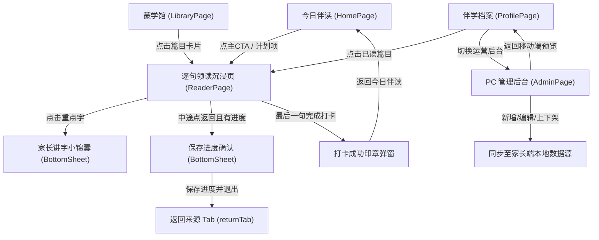

# 01 · 需求理解与页面流程（PRD & User Flow）

> 产品场景拆解、核心任务链路与多端页面返回栈规范。

## 1. 用户画像与核心痛点

- **核心使用者**：3–8 岁儿童的家长（常在睡前 21:00–22:00 或接送间隙使用，往往需要**单手抱娃或躺卧操作**）。
- **辅助协同设备**：小笺智能硬件伴读笔 S1（通过蓝牙连接，同步今日篇目音频，也支持脱离硬件直接手机领读）。
- **真实痛点**：
  1. **不知道今天带孩子读什么**：书库太庞大导致决策疲劳；
  2. **自己也不会讲国学**：认识字但讲不清字源、背景和如何引导孩子提问；
  3. **难以坚持**：没有轻量 5 分钟闭环与正向陪伴反馈，三天打鱼两天晒网。

## 2. 核心业务目标

围绕**「家长每日 5 分钟蒙学伴读与打卡」**建立极短链路闭环：
- 首页只保留 **1 个主任务卡 + 1 个明确主 CTA**，让家长 1 秒进入伴读；
- 逐句领读页提供**大字楷体 + 逐字拼音 + 点击生字弹出「白话讲法与亲子提问」**；
- 硬件在线时同步，硬件断开时无缝降级手机领读。

## 3. 页面流程与返回栈规则

### 返回栈（Back Stack）设计细节
1. **来源 Tab 记忆（`returnTab`）**：从「蒙学馆」或「伴学档案」点进 `ReaderPage` 后，点击左上角返回会精确回到原 Tab，而不是硬编码跳回首页。
2. **中途退出防误触保护**：当 `lineIndex > 0` 且尚未打卡时，点击返回弹出二次确认抽屉，自动保留当前句进度（`saveReadingProgressSync`），首页重新渲染时按钮文案自动变为「继续今日伴读 · 上次读到第 X/Y 句」。
3. **微信小程序形态避让**：在 `miniprogram` 模式下，顶部导航栏右侧预留 `96px` 避让区（`--mp-capsule-space`），防止右侧操作按钮与微信原生胶囊重合。
